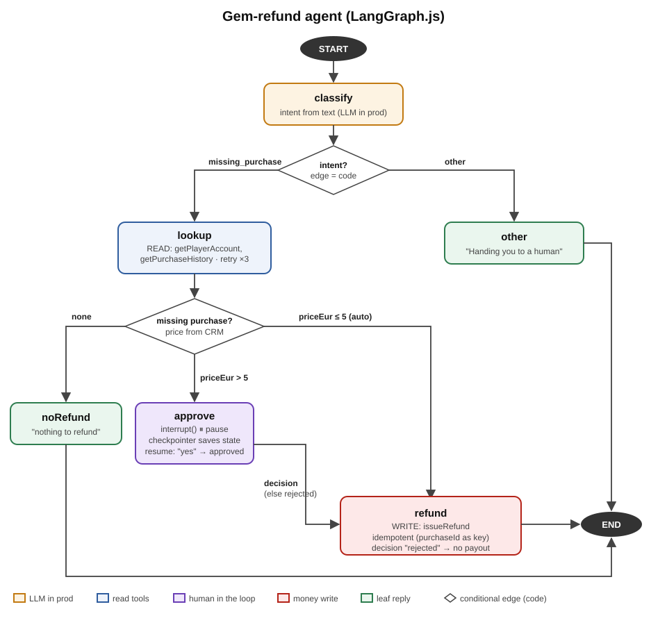

# langgraph-refund-agent

A small LangGraph.js agent with an XState conversation layer, built to learn both hands-on. It handles a support case from a game:
"I bought gems but they never arrived."



## What it shows
- **Conditional routing in code**: the intent and the refund threshold are decided by edge functions, not by a model.
- **Human in the loop**: refunds over 5 EUR pause the graph with `interrupt()` and wait for an approval. Only an explicit "yes" pays out (fail closed).
- **Checkpointing + resume**: a `MemorySaver` checkpointer stores the paused state per `thread_id`; `new Command({ resume })` continues it.
- **Retries**: the CRM-reading node has a `retryPolicy` (backoff with jitter) and survives injected timeouts.
- **Recursion limit**: `recursionLimit` stops runaway runs; the error is caught and turned into a hand-off.
- **Idempotent write**: the refund uses the purchase ID as an idempotency key, so a repeated call pays once.

- **Conversation layer (XState)**: a state machine owns the chat; the graph does the work (see below).

The CRM is a fake in-memory module (`src/crm.ts`), and intent classification is rule-based where a real system would use an LLM.

## Run
```
npm install
npm start       # graph demo
npm run chat    # conversation demo (XState + graph)
npm test        # 17 tests on the money paths
npm run typecheck
```

Sample output of `npm start`:
```
p1: Refund result: {"status":"ok","purchaseId":"pur-101","creditedGems":500,"newBalance":620}
p3: All your purchases were delivered, nothing to refund.
p2: paused -> { playerId: 'p2', message: 'Approve refund of 49.99 EUR?' }
p2: human said yes -> Refund result: {"status":"ok","purchaseId":"pur-202","creditedGems":6500,"newBalance":6540}
Retrying task "lookup" after 541.70ms (attempt 1) after Error: Error: CRM timeout on getPlayerAccount
Retrying task "lookup" after 977.26ms (attempt 2) after Error: Error: CRM timeout on getPlayerAccount
p1 after 2 CRM timeouts: All your purchases were delivered, nothing to refund.
recursion limit hit -> hand off to a human with a summary
```

## Conversation layer (XState)
`src/conversation.ts` wraps the graph in an XState v5 machine, one actor per chat:

```
listening -> working -> awaitingApproval -> resuming -> resolved
                 \-> listening (unclear, max 2 questions)      \-> escalated
ASK_FOR_HUMAN from any state -> escalated
```

- **XState decides what is allowed right now.** `APPROVED` does nothing unless an approval is pending; a message sent while the agent is running is ignored; after 2 clarifying questions the chat goes to a human.
- **LangGraph runs the agent**: classification, CRM lookup with retries, the approval pause and the refund. The graph runs inside a `fromPromise` actor.
- **Cancellation**: if the player asks for a human mid-run, the machine leaves `working` and the actor's `AbortSignal` cancels the graph run, so no refund happens behind the escalation (there's a test for it).
- **Final states**: `resolved` and `escalated` stop the actor, so a finished chat ignores later events. A new message is a new conversation.

Sample output of `npm run chat`:
```
small refund (p1)
  states:  listening -> resolved
  agent:   Refund result: {"status":"ok","purchaseId":"pur-101","creditedGems":500,"newBalance":620}
big refund, human approves (p2)
  states:  listening -> awaitingApproval -> resolved
  agent:   Checking with a colleague, one moment.
  agent:   Your gems are back. Anything else?
APPROVED before anything is pending is ignored (p2)
  states:  listening -> listening
unclear x3 (p1)
  states:  listening -> listening -> listening -> escalated
  agent:   Sorry, I didn't get that. What happened with your purchase?
  agent:   Sorry, I didn't get that. What happened with your purchase?
  agent:   Connecting you to a human agent with a summary of this chat.
player asks for a human mid-approval (p2)
  states:  listening -> awaitingApproval -> escalated
  agent:   Checking with a colleague, one moment.
  agent:   Connecting you to a human agent with a summary of this chat.
```

## Tests
`test/agent.test.ts` covers what must never go wrong with money:
- a small missing purchase is refunded automatically, a delivered one is not
- a big refund pauses and pays nothing until a human answers
- "yes" pays once, "no" pays nothing, anything unexpected fails closed
- the same purchase can't be credited twice (idempotency key)
- CRM timeouts are retried; the recursion limit stops a run

`test/conversation.test.ts` covers the conversation layer:
- small refund resolves; big refund waits, `APPROVED` pays once, `REJECTED` escalates and pays nothing
- `APPROVED` with nothing pending is ignored
- unclear messages: 2 clarifying questions, then a human
- CRM down after the graph's retries: escalated, nothing paid
- `ASK_FOR_HUMAN` mid-approval escalates; a finished chat ignores later events
- `ASK_FOR_HUMAN` mid-run aborts the graph before it refunds

## Layout
- `src/graph.ts`: state, nodes and graph wiring
- `src/crm.ts`: fake in-memory CRM with simulated timeouts
- `src/agent.ts`: graph demo
- `src/conversation.ts`: XState conversation machine around the graph
- `src/chat.ts`: conversation demo
- `test/`: tests (Node's built-in test runner)

## Notes
- `interrupt()` re-runs its node from the top on resume, so no side effects go before it.
- `recursionLimit` counts super-steps including the input step; retries inside a node don't count.
- `STEPS.md` is the step-by-step exercise I followed.
